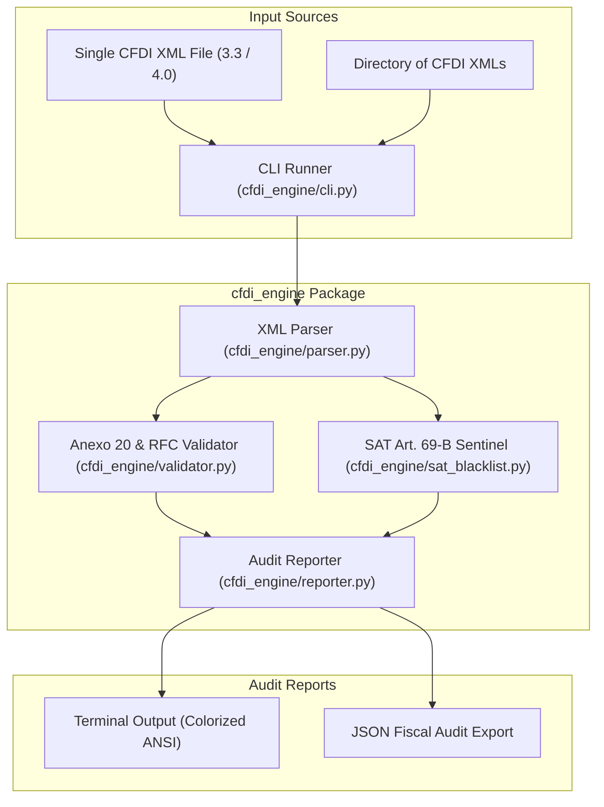
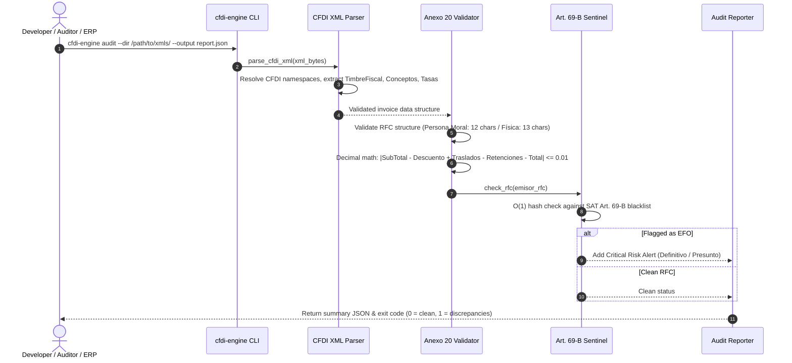

# 🏛️ CFDI SAT Engine Architecture & System Topology

Pure standard-library Python package and CLI for high-performance Mexican CFDI 3.3 and 4.0 fiscal auditing, Anexo 20 math validation, and SAT Article 69-B (EFOS) fraud screening. Designed with zero third-party cloud dependencies, running fully offline with sub-millisecond per-voucher verification.

---

## 1. Technology Stack

| Layer | Technology | Details |
| :--- | :--- | :--- |
| **Runtime & Language** | Python 3.10+ Standard Library | Zero external dependencies (`xml.etree.ElementTree`, `decimal`, `csv`, `re`) |
| **Arithmetic Precision** | `decimal.Decimal` | Eliminates floating-point rounding errors on financial tax calculations |
| **Blacklist Screening** | O(1) In-Memory Hash Lookup | Precompiled set of official SAT Article 69-B RFCs (Definitivos, Presuntos) |
| **CLI Framework** | `argparse` | Command-line tool with batch directory scanning, JSON, and text output |
| **Test Suite** | `pytest` | Comprehensive unit tests for Anexo 20 math, EFOS detection, and XML malformations |

---

## 2. System Topology & Component Graph



---

## 3. Fiscal Audit Lifecycle



---

## 4. Directory Structure & Module Breakdown

```
cfdi-sat-engine/
├── cfdi_engine/              # Core Python package
│   ├── __init__.py           # Package version and export definitions
│   ├── parser.py             # Pure xml.etree CFDI 3.3/4.0 element resolver and data models
│   ├── validator.py          # Decimal math reconciliation and RFC regex checks
│   ├── sat_blacklist.py      # Embedded SAT Art. 69-B RFC blacklist and fast lookup
│   ├── reporter.py           # Formats audit results into text, ANSI tables, and JSON
│   └── cli.py                # Command-line driver for automation and batch pipelines
├── tests/                    # Pytest test suite (6 tests, 100% pass)
│   ├── fixtures/             # Canonical test XML samples
│   │   ├── sample_valid.xml  # Compliant CFDI 4.0 invoice
│   │   ├── sample_invalid_math.xml # Incompatible Anexo 20 rounding discrepancy
│   │   └── sample_efos.xml   # Invoice issued by simulated Art. 69-B shell supplier
│   └── test_cfdi_engine.py   # Unit tests covering parsing, math checks, and EFOS flagging
├── pyproject.toml            # Build configuration and dependencies
└── README.md                 # CLI usage guide and Python API examples
```
