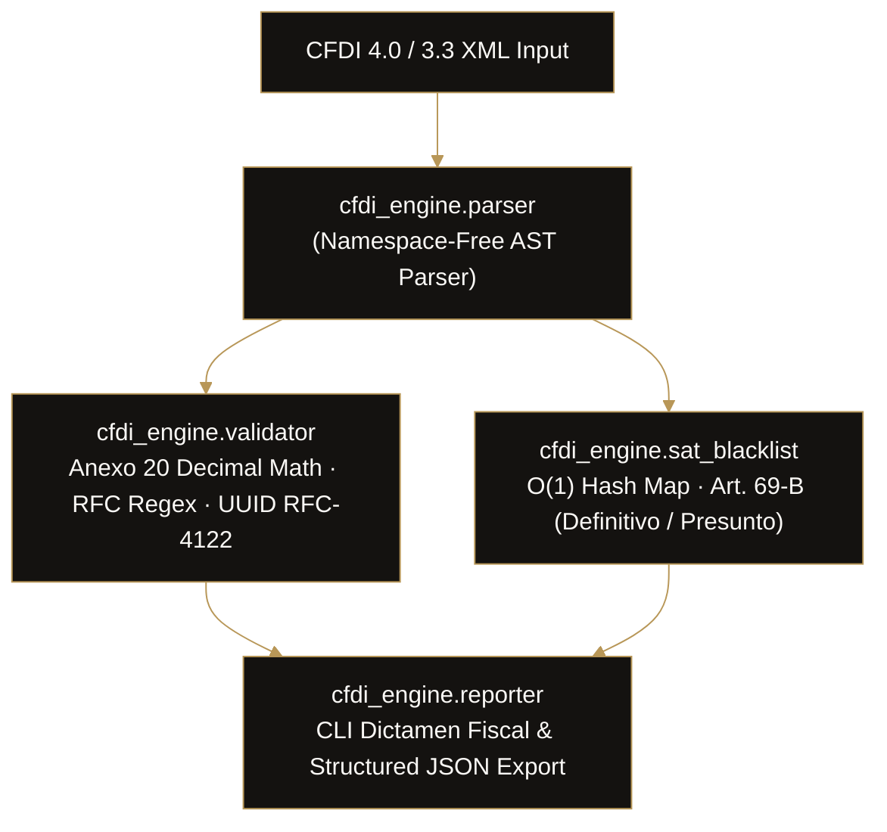

# CFDI SAT Engine

<p align="left">
  <strong>High-Throughput Mexican CFDI 4.0 / 3.3 Fiscal Auditor & SAT Art. 69-B (EFOS) Sentinel</strong><br>
  Open-Source Engine by <a href="https://github.com/iamhuitron"><strong>Ian Miguel Delgado Huitrón</strong></a> · Co-Founder at <a href="https://github.com/Xaol-Studio"><strong>@Xaol-Studio</strong></a>
</p>

<p align="left">
  <a href="https://github.com/iamhuitron"></a>
  <a href="https://github.com/Xaol-Studio"></a>
</p>

<p align="left">
  <a href="https://github.com/iamhuitron/cfdi-sat-engine/actions/workflows/ci.yml"></a>
  
  
  
  <a href="LICENSE"></a>
</p>

> **High-performance Mexican CFDI 4.0 / 3.3 fiscal auditor, Anexo 20 math validator, and official SAT Article 69-B (EFOS) sentinel.** Zero external runtime dependencies. 100% standard library Python.

> 🌐 **Fiscal Ecosystem — Looking for an in-browser interactive Web UI with Excel export?**  
> Check out **[CFDI Sentinel](https://github.com/iamhuitron/cfdi-sentinel)**: Our 100% client-side Next.js / React 19 web application for drag-and-drop XML/ZIP auditing, visual KPI dashboards, and DIOT calculation with zero server exposure. Demo: [xaol-website.vercel.app/demo/sat-sentinel.html](https://xaol-website.vercel.app/demo/sat-sentinel.html)

---

## ⚡ Key Highlights

* **Zero Third-Party Dependencies:** Powered strictly by Python's standard library (`xml.etree.ElementTree`, `decimal`, `csv`, `re`). Ultra-fast execution and zero supply-chain risk.
* **$O(1)$ SAT 69-B (EFOS) Sentinel:** Instant cross-referencing against official blacklists for simulated fiscal operations (*Definitivo, Desvirtuado, Presunto*).
* **Anexo 20 Mathematical Precision:** High-precision Decimal verification of:
  $$\text{SubTotal} - \text{Descuento} + \sum \text{Traslados} - \sum \text{Retenciones} = \text{Total}$$
* **RFC Format Intelligence:** Regex validation distinguishing Persona Moral (12 chars), Persona Física (13 chars), and generic RFCs (`XAXX010101000`, `XEXX010101000`).
* **High-Throughput Batch Auditing:** Audit thousands of XML invoices in seconds with consolidated terminal and JSON summaries.

---

## 🏗️ Architecture



---

## 🚀 Quick Start

### 1. Installation
Clone the repository:
```bash
git clone https://github.com/iamhuitron/cfdi-sat-engine.git
cd cfdi-sat-engine
```

### 2. Audit a single CFDI XML:
```bash
python3 -m cfdi_engine.cli audit tests/fixtures/sample_efos.xml
```

**Terminal Output:**
```text
====================================================================
 🏛️  DICTAMEN FISCAL AUTOMATIZADO CFDI 4.0 / SAT
====================================================================
UUID:       9B8A7C6D-5E4F-4A3B-2C1D-0E9F8A7B6C5D
Serie/Folio:F-999 | Tipo: I | Fecha: 2026-03-01T12:00:00
Emisor:     DISTRIBUIDORA COMERCIAL FANTASMA SA DE CV (XEF980101XYZ)
Receptor:   CLIENTE EJEMPLAR SA DE CV (CTE900202ABC)
--------------------------------------------------------------------
SubTotal:   $50,000.00 MXN
Descuento:  $0.00
Traslados:  $8,000.00
Retenciones:$0.00
TOTAL:      $58,000.00
--------------------------------------------------------------------
🛡️  ALERTA SAT ARTÍCULO 69-B (EFOS):
  🚨 PELIGRO: Emisor en lista negra SAT! Situación: Definitivo
     Oficio: 500-05-2023-14523 | Fecha DOF: 2023-04-15
  ✓ Receptor: Limpio
--------------------------------------------------------------------
📐  INTEGRIDAD Y MATEMÁTICA ANEXO 20:
  ✓ Fórmulas cuadran exactamente. Todos los RFCs son válidos.
====================================================================
```

### 3. Output as JSON for integration with APIs or databases:
```bash
python3 -m cfdi_engine.cli audit tests/fixtures/sample_valid.xml --json
```

### 4. Audit an entire directory of invoices:
```bash
python3 -m cfdi_engine.cli batch /path/to/invoices_folder/
```

### 5. Check any RFC directly against the SAT 69-B Blacklist:
```bash
python3 -m cfdi_engine.cli check-rfc XEF980101XYZ
```

---

## 🐍 Python API Usage

```python
from pathlib import Path
from cfdi_engine.parser import parse_cfdi_xml
from cfdi_engine.validator import validate_cfdi_math
from cfdi_engine.sat_blacklist import EFOSSentinel

# 1. Parse CFDI
cfdi = parse_cfdi_xml(Path("tests/fixtures/sample_valid.xml"))

# 2. Validate Anexo 20 Math
result = validate_cfdi_math(cfdi)
if not result.is_valid:
    print(f"Inconsistencias: {result.issues}")

# 3. Screen for Tax Fraud / EFOS
sentinel = EFOSSentinel()
flagged = sentinel.check_rfc(cfdi["emisor"]["rfc"])
if flagged:
    print(f"ALERTA: Proveedor catalogado como EFOS: {flagged['situacion']}")
```

---

## 🧪 Running Tests

```bash
python3 -m unittest discover -s tests -v
```

All tests execute in milliseconds using standard `unittest`.

---

## 📄 License
MIT License. Created by [Ian Miguel Delgado Huitron](https://github.com/iamhuitron).
